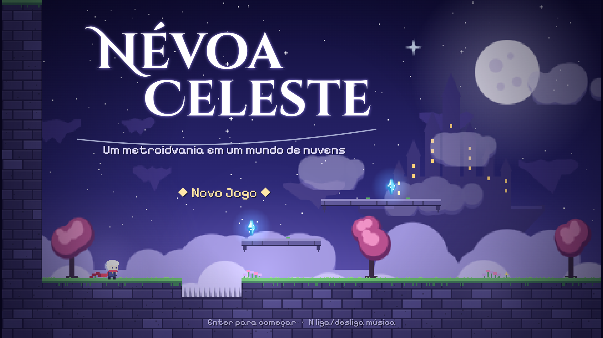
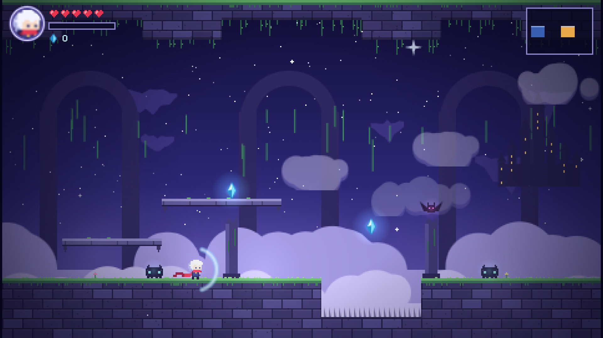
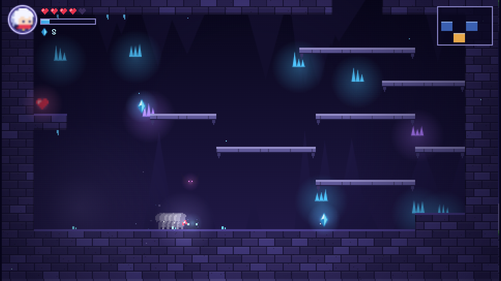
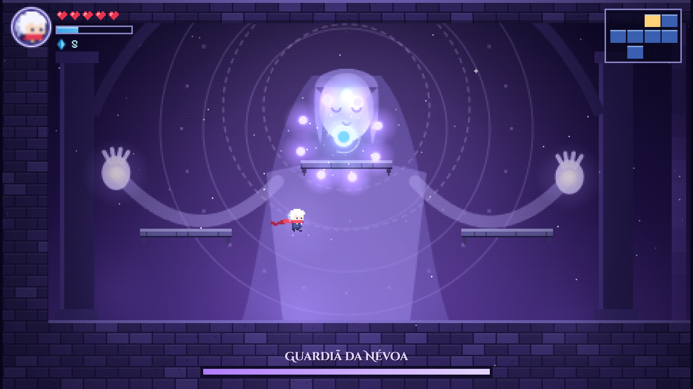
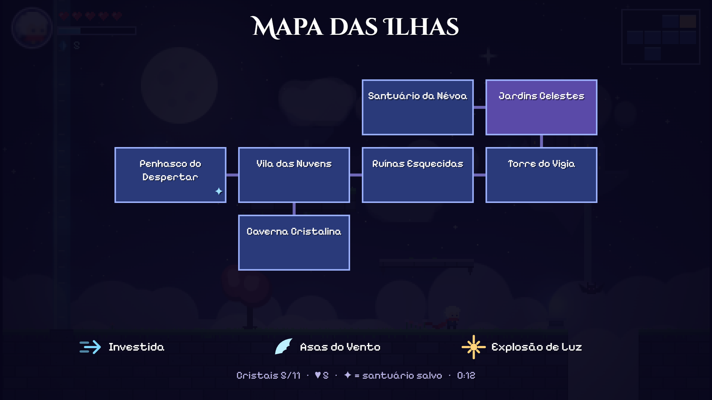

# 🌙 Névoa Celeste

**Um metroidvania em pixel art em um mundo de ilhas flutuantes, que roda direto no navegador.**

### 🎮 [Jogar agora](https://viniciusbqueiroz.github.io/nevoa-celeste/)



Projeto criado para praticar e aplicar conhecimentos de **front-end** além de telas e formulários: renderização, física, áudio, estado e responsividade. Tudo em **HTML5, CSS e JavaScript puro**, sem frameworks, sem engine e sem imagens externas.

---

## ✨ Sobre o jogo

Uma névoa antiga cobriu as ilhas do céu. Explore 7 áreas conectadas, desbloqueie habilidades que abrem novos caminhos e enfrente a **Guardiã da Névoa**.

- 🗺️ **7 áreas interligadas:** Penhasco do Despertar, Vila das Nuvens, Caverna Cristalina, Ruínas Esquecidas, Torre do Vigia, Jardins Celestes e Santuário da Névoa
- ⚡ **3 habilidades para desbloquear:** Investida, Asas do Vento (pulo duplo) e Explosão de Luz
- 👾 Inimigos, cristais escondidos e um fragmento de coração secreto
- 👁️ Chefe final com duas fases e três padrões de ataque
- 💾 Santuários que salvam o progresso
- 📱 Controles de teclado no computador e de toque no celular

| | |
|---|---|
|  |  |
|  |  |

## 🕹️ Controles

| Ação | Teclado | Celular |
|---|---|---|
| Mover | ← → ou A D | Botões ◀ ▶ |
| Pular (segure para ir mais alto) | Z ou Espaço | Pular |
| Atacar (↑ para cima, ↓ no ar para baixo) | X | Atacar |
| Investida | C ou Shift | Avanço |
| Explosão de Luz | V | Luz |
| Falar / usar santuário | ↑ ou E | ▲ |
| Descer de plataformas | ↓ + Z | ▼ + Pular |
| Mapa / Pausa | M / Esc | M / II |

## 🛠️ Tecnologias e técnicas

- **Canvas API:** o jogo é desenhado em uma resolução interna de 480×272 e ampliado com `image-rendering: pixelated`; os textos ficam numa camada separada em alta resolução, para não perder nitidez
- **Loop com passo fixo (60 atualizações/s):** a física funciona igual em monitores de 60 Hz ou 144 Hz
- **Colisão com tiles (AABB):** colisão separada por eixo, plataformas atravessáveis, *coyote time* e *jump buffer* para o controle ficar responsivo
- **Pixel art gerada por código:** sprites definidos como texto, cenários com geração procedural (sementes fixas) e cache em canvas fora da tela para economizar processamento
- **Web Audio API:** efeitos sonoros e trilha criados com osciladores, sem nenhum arquivo de áudio
- **localStorage:** salvamento do progresso
- **Touch Events:** controles virtuais para celular
- **Responsivo:** a tela se ajusta a qualquer tamanho de janela, considerando a densidade de pixels (`devicePixelRatio`)

## 🚀 Rodando localmente

Basta abrir o `index.html` no navegador. Se preferir, sirva a pasta com um servidor estático:

```bash
python -m http.server 8000
```

Depois acesse `http://localhost:8000`.

---

